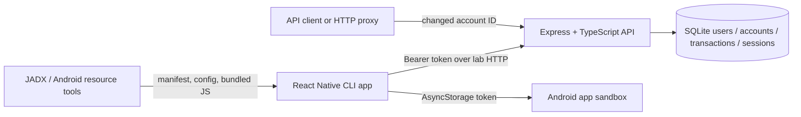

# Architecture

## Components and flow

The mobile app is a bare React Native Community CLI application with its Android Gradle project checked in. It uses React Native core UI elements, `fetch`, and AsyncStorage, keeping the code path small for the talk. Expo is not used. Keeping the native project in the repository makes the manifest and XML network policy easy to inspect, at the cost of maintaining the Gradle project directly.

The API is Express 5 and TypeScript. By default, local development uses `better-sqlite3`; when `MYSQL_URL` is set, the API uses MySQL through `mysql2`. Both hold fake users, accounts, transactions, and bearer sessions. The hosted configuration requires `MYSQL_SSL_CA` so the API verifies Aiven's database certificate over TLS. Seeded passwords are simple training fixtures, stored as scrypt hashes; newly created accounts receive a synthetic balance and an empty history. Login/registration return a server-side session token; logout invalidates it. Transfers update balances and insert paired transactions in one database transaction.

## Network and authorization boundary

The API listens on `127.0.0.1:3000` by default. Android Emulator reaches host loopback through `10.0.2.2`; Genymotion commonly uses `10.0.3.2`. `LAB_API_BASE_URL` sets the public mobile endpoint at bundle/build time. This value is public client config and is bundled. The fake `LAB_DEMO_SECRET` value makes the same bundling visible for Exercise G; real secrets must stay server-side. The Android manifest points to `res/xml/network_security_config.xml`: cleartext is denied by the base policy and permitted only for the emulator host aliases used by this lab. The local HTTP requests intentionally have no TLS so the transport exercise can be observed.

`AUTHZ_MODE=vulnerable` verifies the bearer session but intentionally skips account ownership checks for account and transaction reads. `AUTHZ_MODE=corrected` checks that each requested account belongs to the authenticated user. Both modes enforce source-account ownership for transfers; changing client navigation cannot alter the server decision.

Exercise A's static fake console key exposes only a synthetic support message. Exercise C's endpoint returns an authenticated user's synthetic account balance over HTTP. No route integrates with a real financial provider. Use a local instance for vulnerable BOLA demonstrations. The optional Render playground stays in corrected mode and disables reset. Local storage remains SQLite; the hosted API uses Aiven MySQL.

## Exercise mapping

| Exercise | Component | Main evidence |
| --- | --- | --- |
| A | `src/config.ts`, `/api/lab/support-info` | Static key in bundled JS; controlled response with key |
| B | `apps/api/src/app.ts` | Same authenticated request succeeds in vulnerable mode and receives 403 in corrected mode |
| C | `AndroidManifest.xml`, `network_security_config.xml`, `/api/lab/cleartext/:accountId` | APK policy and HTTP request/response |
| D | `src/App.tsx` | Session persisted with AsyncStorage; inspect app-private database |
| E | `src/App.tsx` | Login writes token to Android logs; safe logging alternative in same function |
| G | `src/config.ts`, `.env.example` | Fake `.env` value shown in the app and recoverable from its bundled JavaScript |
| F | Not implemented | See optional exercise note |
